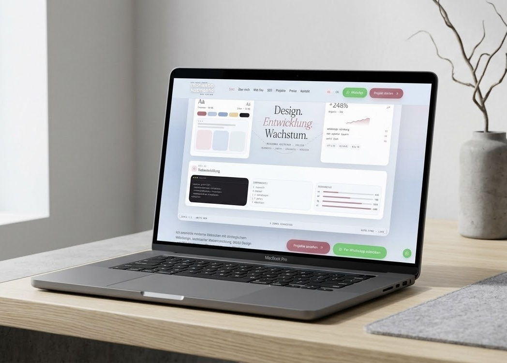
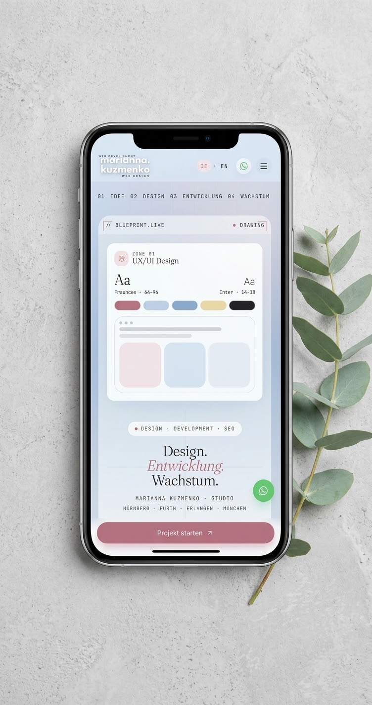
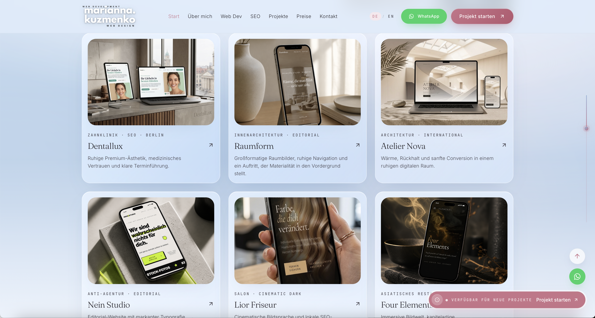

# Marianna Kuzmenko | Web Design & Development

**Web Design · Frontend Development · UX/UI · SEO**

---

## About

Welcome to my professional portfolio.

I'm Marianna Kuzmenko, a Web Designer and Developer focused on creating modern, responsive, and user-friendly digital experiences for businesses, brands, and entrepreneurs.

My work combines UX/UI design, frontend development, SEO, and digital strategy - from the first idea and visual concept to development, testing, and deployment.

---

## Portfolio Preview

### Desktop

### Mobile

### Projects

---

## What I Do

- **Web Design** - modern and responsive website design
- **Frontend Development** - functional and interactive web interfaces
- **UX/UI Design** - user journeys, structure, and intuitive interfaces
- **SEO** - search-friendly website structure and on-page optimization
- **Digital Strategy** - translating business goals into effective digital solutions

---

## Technologies & Tools

- HTML5
- CSS3
- JavaScript
- TypeScript
- React
- Tailwind CSS
- Figma
- Git & GitHub
- Visual Studio Code
- Netlify
- AI-assisted development tools

The exact technology stack can vary depending on the project.

---

## My Workflow

### 1. Discovery

Understanding the business, target audience, goals, and requirements.

### 2. UX/UI Design

Creating the structure, user flow, wireframes, and visual direction in Figma.

### 3. Development

Turning the design into a responsive and functional web experience.

### 4. Testing & Optimization

Checking responsiveness, usability, interactions, and overall performance.

### 5. Deployment

Publishing the finished website and reviewing the live result across different devices.

---

## Selected Work

My portfolio includes websites and digital projects created for different industries and business needs - from creative brands and local businesses to healthcare, wellness, hospitality, and digital products.

Visit my portfolio to explore the complete collection of projects:

**[View My Portfolio →](https://marianna-kuzmenko.com)**

---

## Project Goals

This website serves as my professional portfolio and demonstrates both my creative and technical skills.

It brings together my experience in:

- Web Design
- Frontend Development
- UX/UI Design
- Responsive Design
- SEO
- Digital Strategy

The goal is to create digital experiences that are not only visually appealing, but also clear, functional, and useful for the people who use them.

---

## Live Website

🌐 **[marianna-kuzmenko.com](https://marianna-kuzmenko.com)**

---

## Contact

**Marianna Kuzmenko**  
Web Designer & Developer

- 🌐 Website: [marianna-kuzmenko.com](https://marianna-kuzmenko.com)
- 💻 GitHub: [github.com/mariannakuzmenko](https://github.com/mariannakuzmenko)
- ✉️ Email: mari1992.kuzmenko@gmail.com

---

*Thoughtful design. Functional development. Digital experiences with purpose.*
